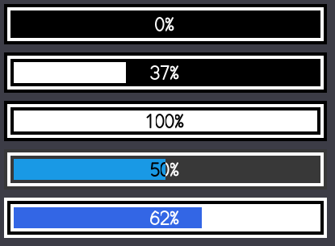
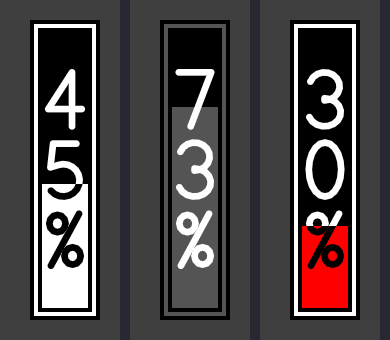
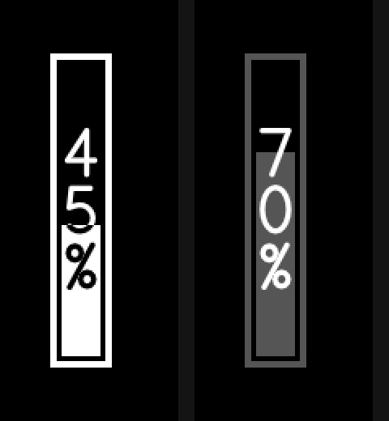
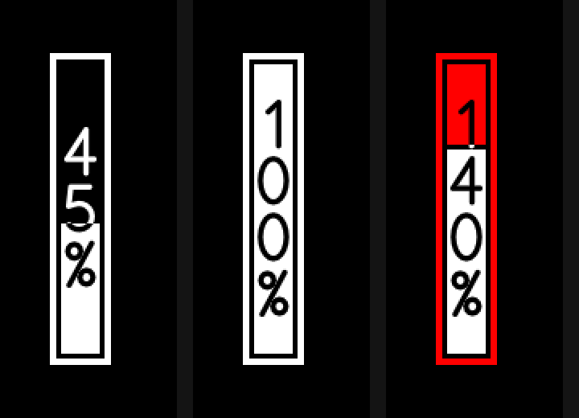
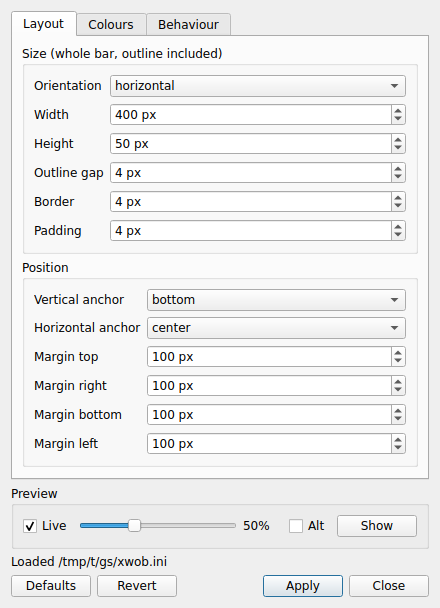

# xwob

One command that shows an overlay volume / brightness / progress bar on **both**
X11 and Wayland, now with a **percentage label whose colour follows what it is
drawn on**.

```
echo 50 | xwob
```

`xwob` looks at your session and starts the right program:

| Session | Runs | Source in this repo |
|---------|------|---------------------|
| Wayland (`WAYLAND_DISPLAY` set) | fork of [wob](https://github.com/francma/wob) | `wob/` |
| X11 (`DISPLAY` set)             | fork of [xob](https://github.com/florentc/xob) | `xob/` |

The two forks stay separate programs, but they read **one shared config file**,
`xwob.ini`, so the bar has the same size, position and colours on both. xwob adds
a small launcher, a single systemd socket/service, and one build. Input on stdin
and all options are handed to the program that gets started.

## Screenshots

Each pixel of the label is black or white depending on what is under it, so a
label that crosses the fill edge flips colour right at the edge (see `45%` and
`50%` below). Vertical bars stack the characters upright, one per line;
horizontal bars show the label on one line.

### Horizontal bar

Rendered with the default `400×50` size at `0%`, `37%`, `100%`, a translucent
blue style at `50%`, and a light style at `62%`. The label stays readable on
dark, light and coloured fills, and flips colour where it crosses the fill edge.

<p align="center">
  
</p>

### Wayland (wob fork) (Vertical bar)

`xwob` running in a Wayland session (headless sway). Inputs, left to right:
`45`, `73!` (alt style, gray), `130` (wraps to 30% and switches to the overflow
colour).

<p align="center">
  
</p>

### X11 (xob fork) (Vertical bar)

`xwob` running in an X11 session. Inputs, left to right: `45`, `70!` (alt style).

<p align="center">
  
</p>

The X11 backend also supports xob's proportional overflow. Inputs, left to
right: `45`, `100`, `140` (the red part is the overflow, the white part is the
in-range portion):

<p align="center">
  
</p>

<details>
<summary>Full-screen captures</summary>

**Wayland** (1280×720)


**X11** (800×600)


</details>

## What changed in the forks

* **`NN%` label** on the bar. Each pixel of the text is black or white,
  whichever contrasts with what is under it (fill colour or background), so the
  label stays readable on both sides of the fill edge.
  Horizontal bars show `45%`; **vertical bars stack the characters upright, one
  per line** (`4`, `5`, `%`).
  Built-in vector font: no font files, no FreeType (wob runs under seccomp).
  Turn off with `show_percentage = no` (xwob.ini; `percentage = false;` in a legacy xob.cfg).
* **xob:** fixed a crash when no config file exists anywhere (it now uses the
  built-in defaults).
* **wob:** understands xob's `50!` shorthand (uses a built-in `alt` style, which
  you can restyle with `[style.alt]`), so the same input lines work on both.

## Build and install

Dependencies: a C compiler, `make`, plus
* X11 backend: `libx11`, `libxrender`, `libconfig`
* Wayland backend: `meson`, `ninja`, `wayland`, `wayland-protocols`, `inih`, optionally `libseccomp`, `scdoc` (man pages)
* Settings GUI (optional): a C++17 compiler and `Qt6Widgets` (`qt6-base-dev` / `qt6-qtbase-devel`)

```
make                      # both backends
make WITH_X11=no          # Wayland only
make WITH_WAYLAND=no      # X11 only
make WITH_GUI=no           # without the Qt6 settings GUI
sudo make install PREFIX=/usr sysconfdir=/etc
```

Packagers: `DESTDIR`, `bindir`, `libexecdir`, `sysconfdir`, `unitdir`,
`WITH_SYSTEMD=no` are all honoured. The backends install as
`libexec/xwob/xwob-x11` and `libexec/xwob/xwob-wayland`, so they never clash
with a distribution's own `xob`/`wob` packages.

You can also run it straight from the source tree after `make`: `./bin/xwob`.

## Usage

```
xwob [-b auto|wayland|x11] [--print-backend] [backend options...]
```

* Input, one value per line on stdin: `50`, `50!` (alt colours), `50 style` (Wayland).
* `-b x11` / `XWOB_BACKEND=x11` forces a backend. Use it on a Wayland compositor
  that has no `wlr-layer-shell` (GNOME) to go through XWayland. Under XWayland
  both variables are set and `auto` prefers Wayland.
* Config: one file for both backends, `~/.config/xwob/xwob.ini` (then
  `/etc/xwob/xwob.ini`); `-c file` overrides. Start from `examples/xwob.ini`.
  See [Configuration](#configuration).

## Configuration

`xwob.ini` uses wob's ini format and keys (`man xwob-wayland.ini`). The X11
backend reads it natively, so there is no second file to keep in sync:

```ini
width = 400            # size of the whole bar, also for vertical bars
height = 50
border_offset = 4      # gap outside the border
border_size = 4
bar_padding = 4
orientation = horizontal
anchor = bottom        # top/bottom/left/right/center
margin = 100
bar_color = ffffff
background_color = 00000090
overflow_mode = wrap   # wrap | nowrap
show_percentage = yes
[style.alt]            # used by "50!" and "50 alt"
bar_color = 555555
```

Everything also applies to X11: `width`/`height`/`border_*`/`bar_padding` map onto
xob's `length`/`thickness`/`outline`/`border`/`padding`, `anchor` + `margin` onto
its `x`/`y` position, and `max`/`timeout` replace `-m`/`-t` (the command-line
flags still win). The built-in defaults are identical on both backends.

Only these are Wayland-only and ignored on X11: `[output.*]` sections (per-monitor
overrides) and named styles other than `alt`.

**Migrating:** the old per-backend files (`wob.ini`, `xob.cfg`) are still read,
but only when no `xwob.ini` exists. A `wob.ini` works as `xwob.ini` unchanged;
a legacy `xob.cfg` (libconfig) has to be translated by hand:

| xob.cfg | xwob.ini |
|---------|----------|
| `length`, `thickness` | `width`, `height` (outer size = inner size + 2 × (`border_offset` + `border_size` + `bar_padding`)) |
| `outline`, `border`, `padding` | `border_offset`, `border_size`, `bar_padding` |
| `x`, `y` (`relative` + `offset`) | `anchor` + `margin` |
| `color.normal.{fg,bg,border}` | `bar_color`, `background_color`, `border_color` |
| `color.overflow.*` | `overflow_bar_color`, `overflow_background_color`, `overflow_border_color` |
| `color.alt` / `color.altoverflow` | `[style.alt]` (`bar_color`… / `overflow_bar_color`…) |
| `percentage` | `show_percentage` |
| `-m`, `-t` flags | `max`, `timeout` |

The xob-specific `overflow = "proportional"` exists only in
`xob.cfg`; the shared file has `overflow_mode = wrap | nowrap`.

## Settings GUI and live reload

`xwob-settings` is a small Qt6 window for `xwob.ini`, so you don't have to edit
the file by hand:

<p align="center">
  
</p>

* **Live** (on by default) shows the bar on screen with the settings currently
  in the window, saved or not, so you see the result while you edit. The slider
  and **Alt** box choose the value shown.
* **Apply** (Ctrl+S) writes `~/.config/xwob/xwob.ini` and reloads the bars that
  are already running. **No logout or restart is needed**, on X11 or Wayland.
* Keys the window doesn't know and Wayland-only sections (`[output.*]`) in your
  file are kept; comments next to the keys it edits are not.

Reload also works from a keybinding or script: `xwob --reload`.

How it works: wob runs in a seccomp sandbox and cannot reopen files, so the
backends read the config only at start. `xwob` therefore runs the backend as a
child; `xwob --reload` sends it `SIGHUP`, it exits, and `xwob` starts it again
with a freshly read file (standard input, e.g. the systemd FIFO, is handed over
unchanged and nothing is lost). Only the installed backends `xwob-x11` and
`xwob-wayland` are signalled, never a distribution's own `xob`/`wob`, and a bar
started straight from the source tree (`xob/xob`, `wob/build/wob`) is not
reloaded.

Build: it needs Qt6 Widgets and is built automatically when Qt6 is found
(`make WITH_GUI=no` to skip it, `WITH_GUI=yes` to require it). There is no moc
step; the program is a single `.cpp` file.

## systemd (the same way wob does it)

systemd owns a FIFO and starts xwob on the first write:

```
systemctl --user enable --now xwob.socket
systemctl --user import-environment WAYLAND_DISPLAY DISPLAY XAUTHORITY   # from your session startup
echo 50 > $XDG_RUNTIME_DIR/xwob.sock
```

Stop with `systemctl --user stop xwob.service` (the socket keeps listening and
will start it again on the next write) or `systemctl --user disable --now xwob.socket`
to remove it entirely. Do **not** also start xwob from your WM config.

The service has `ConditionEnvironment=|WAYLAND_DISPLAY` / `|DISPLAY`, so it runs
in either kind of session and is skipped when there is no display.

### Without systemd

```
mkfifo "$XDG_RUNTIME_DIR/xwob.sock"
tail -f "$XDG_RUNTIME_DIR/xwob.sock" | xwob &
```

(or run it under your supervisor of choice with the FIFO as stdin).

## Notes

* seccomp sandboxing is wob's and applies to the Wayland backend only.
* Both backends are driven by the same `xwob.ini`. Differences that remain are
  the compositor's: Wayland has per-output sections and fractional scaling,
  X11 has neither, and X11 transparency needs a compositor.
* Licensing: see `LICENSE.md` (xob is GPL-3.0, wob is ISC).
